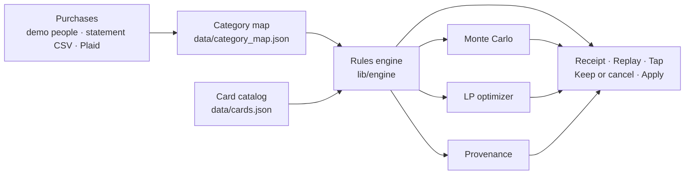

<p align="center">
  <picture>
    <source media="(prefers-color-scheme: dark)" srcset="public/brand/monte-mark-dark.svg">
    
  </picture>
</p>

<h1 align="center">Monte</h1>

<p align="center"><b>Every card played right, and what your cards really cost you.</b></p>

<p align="center">
  <a href="https://ace-eta-beryl.vercel.app">Live site</a> ·
  <a href="https://youtu.be/Tn4YrpoLjh8">Demo video</a> ·
  <a href="https://devpost.com/software/monte-calygj">Devpost</a>
</p>

<p align="center"><sub>ACM@USC TrojanHacks 2026 · 1st place, Finance track</sub></p>

## The problem

Rewards apps show you points. Jordan is 24, first job in LA, three cards. He earned
**$552.69** in rewards last year and paid **$734.72** in interest on a $2,800 balance.
His cards cost him **$427.03** more than they paid him. No rewards app shows that number.

## What Monte does

Monte reads a year of purchases and shows the net: rewards plus perks used, minus fees,
minus interest.

| Section | What you get |
|---|---|
| **Your money** | Where it went, top merchants, what keeps charging you |
| **The Receipt** | Rewards + perks − fees − interest, per card, for the year |
| **Purchases** | Every purchase: the card you used, the card Monte would have picked |
| **Replay** | The same year routed to the best card in the wallet you already have |
| **Tap** | At the register: every card ranked for this store, the winner pays, never one carrying a balance |
| **Keep or cancel** | Each card's fee against the value it adds over your next-best card |
| **Apply** | What to get next, with odds from 1,000 simulated years |

## The app: [`/app`](https://ace-eta-beryl.vercel.app/app)

The story page shows a demo year. `/app` is the product you use at the register, phone first,
installable to the home screen, no account (your cards stay in your browser).

| Tab | What it does |
|---|---|
| **Pay** | Search the store or tap **Near me** (OpenStreetMap), say roughly how much, and Monte names the card, with one sentence on why. A card's credit at that store (Uber Cash, the Dunkin' credit...) comes first. |
| **Cards** | Your wallet: each card's best categories, which ones carry a balance and the order to pay them down, and with a year of purchases, whether each card earns its fee. |
| **Year** | With a bank or statement connected: what your cards made or cost you, each card's net, the biggest misses, what keeps charging you. |
| **Connect** | [Plaid](#connecting-a-bank) Link, a statement CSV, or one of the five demo people. "Forget everything" drops the Plaid item and clears the browser. |

**Online checkout:** the [Chrome extension](extension/) names the card on any store's website,
using the cards you set up in the app.

### Why skip a card with a balance? (interest, not just points)

Mordi Shadpour (Uno Wallet) asked the right question: if you can't pay the balance down, you pay
interest anyway, so how does routing around the card help? [`lib/engine/interest.ts`](lib/engine/interest.ts)
answers in numbers:

- **A card that carries a balance has no grace period.** A new purchase on it accrues interest from
  the day it posts, for as long as the balance revolves. On a card paid in full the same purchase
  costs nothing if that statement is paid. One month at 26% APR is about 2.2% of the purchase, more
  than almost any card earns, so while you have a card paid in full, Monte uses it, and says what
  the other card would have cost.
- **When every card carries a balance, Monte doesn't refuse.** The purchase costs interest wherever
  it goes, so it ranks the cards by reward minus the interest the purchase adds, which usually means
  the lowest APR.

Only a balance that actually revolves counts: a card you pay in full every month always has this
month's purchases on it, and that isn't debt (`revolvingBalance()` in `lib/data/plaid.ts`).

## Does it work?

For Jordan, `scripts/jordan-check.ts` rebuilds the receipt line by line:

| Line | Amount |
|---|---|
| Rewards on the cards he used | $552.69 |
| Credits used | $80.00 |
| Annual fees | −$325.00 |
| Interest | −$734.72 |
| **Net** | **−$427.03** |
| Same purchases, best card in the same wallet | $656.83 |
| **Left on the table** | **$104.14** |

`npm test` runs 55 tests, including five hand-computed earn cases, the interest-aware choice, and a check that the
receipt's sourced lines add up to the engine's total, to the cent, for every demo person.

## How it works



The engine is deterministic. **The AI never does the math.** Every dollar on screen traces
to a published card rule in [`data/cards.json`](data/cards.json), each with the issuer's
source URL and the date we checked it, and to the purchases behind it.

- **Rules engine** (`lib/engine/`): earn rates, spending caps, shared cap pools,
  pick-one categories, quarterly rotations, credits, cash vs travel point values.
- **Monte Carlo** (`lib/engine/montecarlo.ts`): resamples your own months into 1,000
  simulated years and replays the full engine over each one, so caps and quarters
  re-accumulate from zero every year. Seeded, so the same inputs always give the same
  numbers. Runs in 19–313 ms.
- **LP optimizer** (`lib/engine/lp.ts`): caps can make greedy routing sub-optimal, so we
  solve the year as a whole and compare. On the demo wallets greedy turns out to already
  be optimal, and the LP is how we know: it returns a matching upper bound.
- **Provenance** (`lib/engine/provenance.ts`): any dollar returns its rule, the
  arithmetic (`$84.20 × 3x × 2.05¢/point = $5.18`), the issuer source and the date.

Two rules the engine keeps:

1. It never recommends a card that carries a balance.
2. It never shows a number it cannot source.

## Tap to pay

The tap demo plays one purchase at the register, on the engine's real `tap()` and the
selected person's wallet. Open it from the nav, the floating *Try tap to pay* button,
[`/#tap-demo`](https://ace-eta-beryl.vercel.app/#tap-demo) or `?tap`.

| Step | What happens |
|---|---|
| 1. Store code | The reader sends the merchant, amount and category code (MCC), e.g. Trader Joe's, 5411 |
| 2. Wallet | Monte opens the person's cards and their balances |
| 3. Caps | It replays this period's purchases so each card's spending caps are already counted |
| 4. Rank | Every card is scored for this purchase; a card carrying a balance is blocked |
| 5. Pay | The top unblocked card pays |

On screen: a countertop reader with four contactless lights and the approval beep, and an
Apple Pay-style phone holding the Monte card (*Hold Near Reader*), whose cards flip while it
ranks. Nothing is timed: Next, space or the arrow keys move each step on.

**Real:** the ranking, the cap counts, the balance block and the reward on every card.
**Simulated:** the reader, the phone and the NFC. It runs in the browser.

### Why there is no real Monte card

No app can choose the card inside Apple Pay or Google Wallet; only the person can. The
workaround, one Monte card that charges your best card behind the scenes, breaks in four places:

1. **The bonus disappears.** Rewards follow the store's category code. If Monte paid Trader
   Joe's (5411) and then charged your Amex Gold, Amex would see a charge from Monte, not a
   grocery store, and pay 1× instead of 4×.
2. **It can count as a cash advance.** Some issuers treat loading another card as one: a fee
   up front and interest from day one.
3. **The money runs backwards.** Monte would pay about 2–3% in card fees each time it charged
   your real card and earn less than that on the Monte card side.
4. **It takes a bank and months.** Issuing a card needs a partner bank, Visa or Mastercard
   approval and identity checks. Curve runs this model in the UK and Europe, and some issuers
   have blocked it.

So Monte works around the wallet: before you tap it shows the right card for the place you're
at, so you pick it in Apple Pay; after you tap each purchase gets a verdict; once a year it
replays the year to show what each card cost. The Monte card itself is simulated at
[`/brand`](https://ace-eta-beryl.vercel.app/brand).

## Try it

**Online:** the [live site](https://ace-eta-beryl.vercel.app) runs on the demo people. Press `P` (or open `?present`)
for presenter mode and walk the demo with the arrow keys, or open [`/#tap-demo`](https://ace-eta-beryl.vercel.app/#tap-demo) to watch a tap at the register.

**Run it locally:**

```bash
npm install
npm run dev          # http://localhost:3000
npm run check        # typecheck, lint, build
npm test             # 55 tests
npm run smoke        # checks a deployment's demo path
```

**Check the numbers.** Each script prints its working:

```bash
node --import ./scripts/_alias.mjs scripts/test.ts          # 55 tests, hand-computed cases
node --import ./scripts/_alias.mjs scripts/jordan-check.ts  # the −$427.03 receipt, line by line
node --import ./scripts/_alias.mjs scripts/mc.ts            # Monte Carlo odds per person
node --import ./scripts/_alias.mjs scripts/lp-vs-greedy.ts  # LP vs greedy, with a worked cap trap
```

`jordan-check` ends with the two lines in the table above.

## Connecting a bank

The app's Connect tab runs the real Plaid Link flow (`lib/data/plaid-link.ts`): our server makes a
`link_token` (transactions + liabilities), Plaid's own window handles the bank login, the
`public_token` is exchanged server-side, and `/api/plaid/data` returns your cards (with balances and
purchase APRs from liabilities) and a year of purchases, mapped to the engine's types. In sandbox
there's also "Use Plaid's test bank", which skips the Link window. `/api/plaid/forget` removes the
item and the cookie.

**To turn it on** (free sandbox keys from [dashboard.plaid.com](https://dashboard.plaid.com/developers/keys)):

```bash
# .env.local for local dev, and the same three on Vercel
PLAID_CLIENT_ID=...
PLAID_SECRET=...      # the sandbox secret
PLAID_ENV=sandbox
```

```bash
npx vercel env add PLAID_CLIENT_ID production
npx vercel env add PLAID_SECRET production
npx vercel env add PLAID_ENV production
```

Without keys every `/api/plaid/*` route returns `503 plaid_not_configured`, and the app says bank
linking is coming and offers the statement upload and hand-added cards instead. The access token sits
in an httpOnly cookie, which is fine for sandbox; production Plaid needs it stored server-side,
encrypted, per user. More in [`docs/deploy.md`](docs/deploy.md). Keys belong in `.env.local` and the
host's environment. This repo is public.

## Real vs simulated

**Real:** the card catalog (29 cards, terms sourced and dated 2026-10-17), the rules
engine, the Monte Carlo, the LP, the receipt and every number it produces, statement CSV
upload, and the Plaid integration code.

**Simulated:** the five demo people (Jordan, Maya, the Parks, Sam, Rosa) and their
transactions are synthetic. Tap is a web demo, not NFC
(see [Tap to pay](#tap-to-pay)). Plaid runs against the sandbox,
not a real bank.

**Flagged:** cards marked `UNVERIFIED` in the catalog are badged in the UI. Jordan's wallet
is fully verified.

## Repo map

| Path | What's there |
|---|---|
| `app/` | Pages (`/`, `/app`, `/dashboard`, `/brand`, `/engine`) and the API routes: Plaid, `/api/best`, health |
| `components/ace/` | The product's sections: receipt, replay, tap, keep, odds, presenter mode, tap demo |
| `components/app/` | The app at `/app`: Pay, Cards, Year, Connect, and the saved wallet |
| `extension/` | The Chrome extension for online checkout |
| `components/monte-card/` | The simulated Monte card and why it isn't real |
| `components/brand/`, `components/ui/` | The Monte mark, hand-drawn notes, and base UI parts |
| `lib/engine/` | Rules engine, interest-aware choice, Monte Carlo, LP optimizer, provenance, statement CSV parser |
| `lib/merchants.ts`, `lib/perks.ts` | Store name or website -> category; nearby stores; the card credits a store triggers |
| `lib/data/` | The five demo people and the Plaid mapping |
| `data/` | Card catalog and category map, each rule with its source |
| `scripts/` | Verification scripts and the smoke test |
| `tests/` | 55 tests, including hand-computed cases |
| `docs/` | Spec, deploy runbook, brand, judge Q&A |

Each folder has its own README with a line per file.

## Team

Built at **ACM@USC TrojanHacks 2026** (Finance) by Michael Tarekegn (backend: Plaid, Monte Carlo,
LP, tests) and Adrian Erlikhman (product, UI, brand). It won **1st place in the Finance track**.
