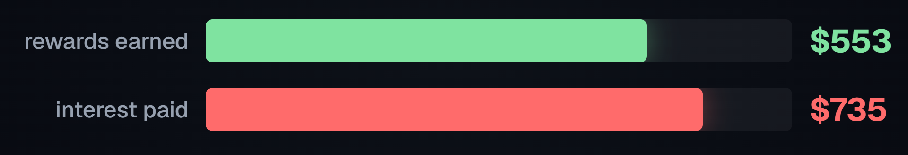
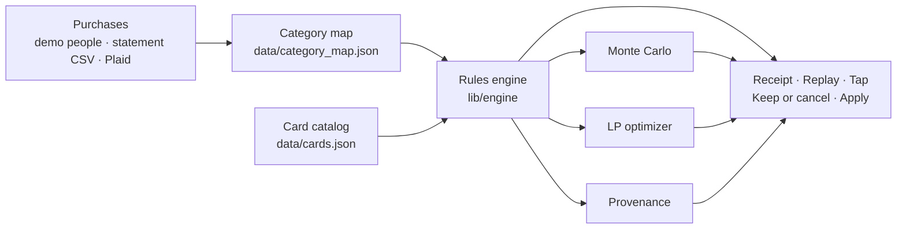

# Monte

**Every card played right, and what your cards really cost you.**

**[Live site](https://ace-eta-beryl.vercel.app)** · **[Demo video](https://youtu.be/Tn4YrpoLjh8)** · [Devpost](https://devpost.com/software/monte-calygj)



## The problem

Rewards apps show you points. Jordan is 24, first job in LA, three cards. He earned **$552.69** in rewards last year
and paid **$734.72** in interest on a $2,800 balance. His cards cost him **$427.03** more
than they paid him. No rewards app shows that number.

## What Monte does

Monte reads a year of purchases and shows the net: rewards plus perks used, minus fees,
minus interest.

| Section | What you get |
|---|---|
| **Your money** | Where it went, top merchants, what keeps charging you |
| **The Receipt** | Rewards + perks − fees − interest, per card, for the year |
| **Purchases** | Every purchase: the card you used, the card Monte would have picked |
| **Replay** | The same year routed to the best card in the wallet you already have |
| **Tap** | The best card at a merchant right now, never one carrying a balance |
| **Keep or cancel** | Each card's fee against the value it adds over your next-best card |
| **Apply** | What to get next, with odds from 1,000 simulated years |

## Does it work?

For Jordan, `scripts/jordan-check.ts` rebuilds the receipt line by line:

| Line | Amount |
|---|---|
| Rewards on the cards he used | $552.69 |
| Credits used | $80.00 |
| Annual fees | −$325.00 |
| Interest | −$734.72 |
| **Net** | **−$427.03** |
| Same purchases, best card in the same wallet | $656.83 |
| **Left on the table** | **$104.14** |

`npm test` runs 36 tests, including five hand-computed earn cases and a check that the
receipt's sourced lines add up to the engine's total, to the cent, for every demo person.

## How it works



The engine is deterministic. **The AI never does the math.** Every dollar on screen traces
to a published card rule in [`data/cards.json`](data/cards.json), each with the issuer's
source URL and the date we checked it, and to the purchases behind it.

- **Rules engine** (`lib/engine/`): earn rates, spending caps, shared cap pools,
  pick-one categories, quarterly rotations, credits, cash vs travel point values.
- **Monte Carlo** (`lib/engine/montecarlo.ts`): resamples your own months into 1,000
  simulated years and replays the full engine over each one, so caps and quarters
  re-accumulate from zero every year. Seeded, so the same inputs always give the same
  numbers. Runs in 19–313 ms.
- **LP optimizer** (`lib/engine/lp.ts`): caps can make greedy routing sub-optimal, so we
  solve the year as a whole and compare. On the demo wallets greedy turns out to already
  be optimal, and the LP is how we know: it returns a matching upper bound.
- **Provenance** (`lib/engine/provenance.ts`): any dollar returns its rule, the
  arithmetic (`$84.20 × 3x × 2.05¢/point = $5.18`), the issuer source and the date.

Two rules the engine keeps:

1. It never recommends a card that carries a balance.
2. It never shows a number it cannot source.

## Try it

**Online:** the [live site](https://ace-eta-beryl.vercel.app) runs on the demo people. Press `P` for presenter
mode, or open [`/#tap-demo`](https://ace-eta-beryl.vercel.app/#tap-demo) to watch a tap at the register.

**Run it locally:**

```bash
npm install
npm run dev          # http://localhost:3000
npm run check        # typecheck, lint, build
npm test             # 36 tests
npm run smoke        # checks a deployment's demo path
```

**Check the numbers.** Each script prints its working:

```bash
node --import ./scripts/_alias.mjs scripts/test.ts          # 36 tests, hand-computed cases
node --import ./scripts/_alias.mjs scripts/jordan-check.ts  # the −$427.03 receipt, line by line
node --import ./scripts/_alias.mjs scripts/mc.ts            # Monte Carlo odds per person
node --import ./scripts/_alias.mjs scripts/lp-vs-greedy.ts  # LP vs greedy, with a worked cap trap
```

`jordan-check` ends with the two lines in the table above.

## Connecting a bank

Plaid sandbox routes live under `app/api/plaid/`. Without keys every route returns
`503 plaid_not_configured` and the app stays on its demo people, so nothing breaks.
With keys, `loadPlaidSandbox()` returns transactions and a wallet in the same shape the
demo people use. Setup and a curl walkthrough: [`docs/deploy.md`](docs/deploy.md).

Keys belong in `.env.local` and the host's environment. This repo is public.

## Real vs simulated

**Real:** the card catalog (29 cards, terms sourced and dated 2026-10-17), the rules
engine, the Monte Carlo, the LP, the receipt and every number it produces, statement CSV
upload, and the Plaid integration code.

**Simulated:** the five demo people (Jordan, Maya, the Parks, Sam, Rosa) and their transactions are synthetic. Tap is a web
demo, not NFC. Plaid runs against the sandbox, not a real bank.

**Flagged:** 11 of the 29 cards are marked `UNVERIFIED` in the catalog and badged in the
UI. Jordan's wallet is fully verified.

## Layout

```
app/            screens and the Plaid + health API routes
components/     UI
lib/engine/     the rules engine, Monte Carlo, LP, provenance
lib/data/       demo people, Plaid mapping
data/           card catalog and category map, with sources
scripts/        verification scripts (see above)
tests/          36 tests, including hand-computed cases
docs/           SPEC.md, HACKATHON.md, deploy.md, BRAND.md
```
