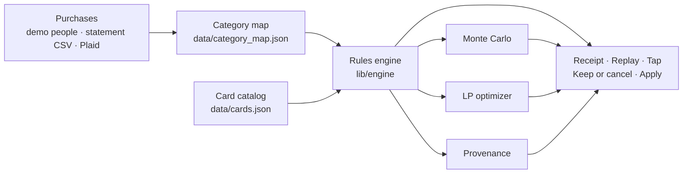

<p align="center">
  <picture>
    <source media="(prefers-color-scheme: dark)" srcset="public/brand/monte-mark-dark.svg">
    
  </picture>
</p>

<h1 align="center">Monte</h1>

<p align="center"><b>Every card played right, and what your cards really cost you.</b></p>

<p align="center">
  <a href="https://ace-eta-beryl.vercel.app">Live site</a> ·
  <a href="https://youtu.be/Tn4YrpoLjh8">Demo video</a> ·
  <a href="https://devpost.com/software/monte-calygj">Devpost</a>
</p>

<p align="center"><sub>ACM@USC TrojanHacks 2026 · Finance</sub></p>

## The problem

Rewards apps show you points. Jordan is 24, first job in LA, three cards. He earned
**$552.69** in rewards last year and paid **$734.72** in interest on a $2,800 balance.
His cards cost him **$427.03** more than they paid him. No rewards app shows that number.

## What Monte does

Monte reads a year of purchases and shows the net: rewards plus perks used, minus fees,
minus interest.

| Section | What you get |
|---|---|
| **Your money** | Where it went, top merchants, what keeps charging you |
| **The Receipt** | Rewards + perks − fees − interest, per card, for the year |
| **Purchases** | Every purchase: the card you used, the card Monte would have picked |
| **Replay** | The same year routed to the best card in the wallet you already have |
| **Tap** | At the register: every card ranked for this store, the winner pays, never one carrying a balance |
| **Keep or cancel** | Each card's fee against the value it adds over your next-best card |
| **Apply** | What to get next, with odds from 1,000 simulated years |

## Does it work?

For Jordan, `scripts/jordan-check.ts` rebuilds the receipt line by line:

| Line | Amount |
|---|---|
| Rewards on the cards he used | $552.69 |
| Credits used | $80.00 |
| Annual fees | −$325.00 |
| Interest | −$734.72 |
| **Net** | **−$427.03** |
| Same purchases, best card in the same wallet | $656.83 |
| **Left on the table** | **$104.14** |

`npm test` runs 36 tests, including five hand-computed earn cases and a check that the
receipt's sourced lines add up to the engine's total, to the cent, for every demo person.

## How it works



The engine is deterministic. **The AI never does the math.** Every dollar on screen traces
to a published card rule in [`data/cards.json`](data/cards.json), each with the issuer's
source URL and the date we checked it, and to the purchases behind it.

- **Rules engine** (`lib/engine/`): earn rates, spending caps, shared cap pools,
  pick-one categories, quarterly rotations, credits, cash vs travel point values.
- **Monte Carlo** (`lib/engine/montecarlo.ts`): resamples your own months into 1,000
  simulated years and replays the full engine over each one, so caps and quarters
  re-accumulate from zero every year. Seeded, so the same inputs always give the same
  numbers. Runs in 19–313 ms.
- **LP optimizer** (`lib/engine/lp.ts`): caps can make greedy routing sub-optimal, so we
  solve the year as a whole and compare. On the demo wallets greedy turns out to already
  be optimal, and the LP is how we know: it returns a matching upper bound.
- **Provenance** (`lib/engine/provenance.ts`): any dollar returns its rule, the
  arithmetic (`$84.20 × 3x × 2.05¢/point = $5.18`), the issuer source and the date.

Two rules the engine keeps:

1. It never recommends a card that carries a balance.
2. It never shows a number it cannot source.

## Tap to pay

The tap demo plays one purchase at the register, on the engine's real `tap()` and the
selected person's wallet. Open it from the nav, the floating *Try tap to pay* button,
[`/#tap-demo`](https://ace-eta-beryl.vercel.app/#tap-demo) or `?tap`.

| Step | What happens |
|---|---|
| 1. Store code | The reader sends the merchant, amount and category code (MCC), e.g. Trader Joe's, 5411 |
| 2. Wallet | Monte opens the person's cards and their balances |
| 3. Caps | It replays this period's purchases so each card's spending caps are already counted |
| 4. Rank | Every card is scored for this purchase; a card carrying a balance is blocked |
| 5. Pay | The top unblocked card pays |

On screen: a countertop reader with four contactless lights and the approval beep, and an
Apple Pay-style phone holding the Monte card (*Hold Near Reader*), whose cards flip while it
ranks. Nothing is timed: Next, space or the arrow keys move each step on.

## Try it

**Online:** the [live site](https://ace-eta-beryl.vercel.app) runs on the demo people. Press `P` for presenter
mode, or open [`/#tap-demo`](https://ace-eta-beryl.vercel.app/#tap-demo) to watch a tap at the register.

**Run it locally:**

```bash
npm install
npm run dev          # http://localhost:3000
npm run check        # typecheck, lint, build
npm test             # 36 tests
npm run smoke        # checks a deployment's demo path
```

**Check the numbers.** Each script prints its working:

```bash
node --import ./scripts/_alias.mjs scripts/test.ts          # 36 tests, hand-computed cases
node --import ./scripts/_alias.mjs scripts/jordan-check.ts  # the −$427.03 receipt, line by line
node --import ./scripts/_alias.mjs scripts/mc.ts            # Monte Carlo odds per person
node --import ./scripts/_alias.mjs scripts/lp-vs-greedy.ts  # LP vs greedy, with a worked cap trap
```

`jordan-check` ends with the two lines in the table above.

## Connecting a bank

The Plaid sandbox routes are in `app/api/plaid/`. Without keys every route returns
`503 plaid_not_configured` and the app stays on its demo people. With keys,
`loadPlaidSandbox()` returns transactions and a wallet in the same shape the demo
people use. Setup and a curl walkthrough: [`docs/deploy.md`](docs/deploy.md).

Keys belong in `.env.local` and the host's environment. This repo is public.

## Real vs simulated

**Real:** the card catalog (29 cards, terms sourced and dated 2026-10-17), the rules
engine, the Monte Carlo, the LP, the receipt and every number it produces, statement CSV
upload, and the Plaid integration code.

**Simulated:** the five demo people (Jordan, Maya, the Parks, Sam, Rosa) and their
transactions are synthetic. Tap is a web demo, not NFC. Plaid runs against the sandbox,
not a real bank.

**Flagged:** cards marked `UNVERIFIED` in the catalog are badged in the UI. Jordan's wallet
is fully verified.

## Repo map

| Path | What's there |
|---|---|
| `app/` | Pages (`/`, `/dashboard`, `/brand`) and the Plaid + health API routes |
| `components/ace/` | The product's sections: receipt, replay, tap, keep, odds, presenter mode |
| `components/brand/`, `components/ui/` | The Monte mark, hand-drawn notes, and base UI parts |
| `lib/engine/` | Rules engine, Monte Carlo, LP optimizer, provenance, statement CSV parser |
| `lib/data/` | The five demo people and the Plaid mapping |
| `data/` | Card catalog and category map, each rule with its source |
| `scripts/` | Verification scripts and the smoke test |
| `tests/` | 36 tests, including hand-computed cases |
| `docs/` | Spec, deploy runbook, brand, judge Q&A |

Each folder has its own README with a line per file.

## Team

Built at **ACM@USC TrojanHacks 2026** (Finance) by Michael Tarekegn (backend: Plaid, Monte Carlo,
LP, tests) and Adrian Erlikhman (product, UI, brand).
