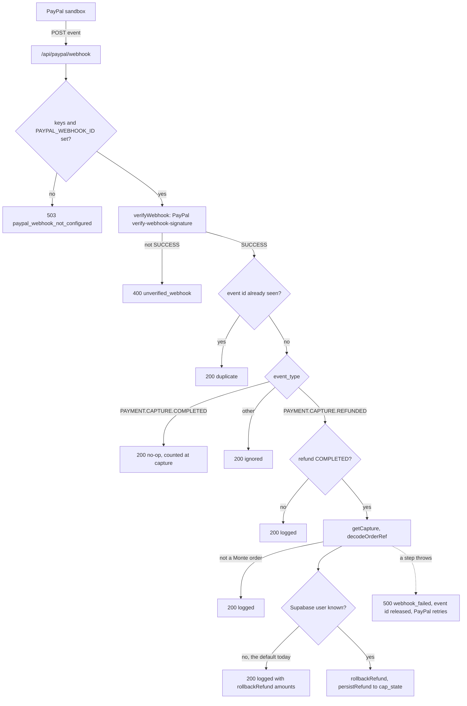

# Monte: architecture

One paragraph, then the parts and how data moves, then the algorithms, then the PayPal and
Plaid layer, every API route and every guardrail.

## 1. In one paragraph

Monte is a deterministic rules engine for credit cards. A catalog of 29 cards
(`data/cards.json`) holds every published earn rule, cap, rotating category, credit, fee
and point value, each with the issuer's source URL and the date we checked it. The engine
plays a year of real purchases through a wallet and produces a receipt: rewards plus perks
used, minus annual fees, minus interest. The same engine is reused by everything else: a
replay that routes each purchase to the best card you already hold, a Monte Carlo that
re-runs the engine over 1,000 resampled years to compare wallets, and an LP that checks
whether the greedy routing was optimal. For speed at the register, a one-time sync stores
how much of each cap is already spent, so a tap reads a few counters instead of replaying
your history. No AI model is in the pricing path. The PayPal layer (`lib/paypal/`) runs the
same engine on the server before it creates an order, and puts the cap back with the same
engine when a refund completes.

## 2. Components and data flow

```
                 data/cards.json  (29 cards: rules, caps, credits, fees, sources, checked dates)
                        |
                        v
   purchases --->  lib/engine/index.ts   evaluate()  -> one purchase on one card, given caps used
   (Plaid or            |                simulate()  -> a year, "actual" or "best" policy
    CSV upload)         |                receipt()   -> rewards + perks - fees - interest
                        |
          +-------------+--------------+-----------------------+
          v                            v                       v
   montecarlo.ts                    lp.ts                provenance.ts
   1,000 resampled years,           MILP over the whole  every dollar -> rule,
   engine replayed per year         year; proves or      source URL, checked date,
   -> odds per wallet option        improves greedy      UNVERIFIED badge

   Production path for the register moment:

   POST /api/sync  (once, slow is fine)          POST /api/tap  (every purchase, fast)
     write holdings + transactions                 read holdings + cap_state (indexed)
     capStateFrom(): walk history once  ---->      capMapFrom(): rebuild cap usage map
     upsert cap_state(card, pool, period, used)    evaluate() each eligible card, rank
                                                   return pick, ranked list, cap notes, ms
```

| Piece | File | Role |
|---|---|---|
| Catalog | `data/cards.json`, `lib/engine/catalog.ts` | Published rules per card, with sources and dates |
| Engine | `lib/engine/index.ts` | `evaluate`, `simulate`, `receipt`, `tap`, `whatIf`, `marginalValue` |
| Monte Carlo | `lib/engine/montecarlo.ts` | Seeded block bootstrap; compares wallet options year by year |
| LP | `lib/engine/lp.ts` | Whole-year assignment with `javascript-lp-solver`; upper bound plus replayed plan |
| Provenance | `lib/engine/provenance.ts` | Traces every line to a rule, URL, date and the purchases behind it |
| Cap cache | `lib/db/cap-state.ts` | `capStateFrom` (sync) and `capMapFrom` (tap) |
| API | `app/api/sync`, `app/api/tap`, `app/api/plaid/*` | Sync once, tap fast, Plaid link, Plaid recurring charges |
| Checkout plan | `lib/paypal/plan.ts` | `planCheckout`: the engine's ranking, pick and cap room for one purchase. Runs in the browser and on the server |
| PayPal client | `lib/paypal/client.ts` | OAuth, Orders v2 create/get/capture, get capture, refund. Sandbox URL only |
| Checkout agent | `lib/paypal/agent.ts`, `app/api/paypal/agent` | Claude with three tools; reply checked against tool output |
| Refund rollback | `lib/paypal/refund.ts`, `lib/paypal/persist.ts` | `rollbackRefund` gives cap room back and reverses rewards in proportion |
| Pay Later | `lib/paypal/paylater.ts` | Pay in 4 schedule vs. interest on the card that carries a balance. Browser only, no API call |
| PayPal import | `lib/paypal/transactions.ts`, `app/api/paypal/transactions` | Transaction Search to engine purchases |
| Webhooks | `lib/paypal/webhook.ts`, `app/api/paypal/webhook` | Verify with PayPal, de-dupe, roll back on refund |
| Plaid recurring | `lib/data/plaid-recurring.ts`, `app/api/plaid/recurring` | The bank's recurring streams, mapped to the Leaks view's shape |
| Database | Supabase Postgres | `profiles`, `bank_items`, `holdings`, `transactions`, `cap_state`, `merchant_overrides`, `card_terms` |

Measured on a laptop: routing a whole year takes about 1 ms; a tap that replays history
takes about 2.9 ms and grows with history; 1,000 Monte Carlo years take about 58 ms
(19 to 313 ms across our test people). The cap cache makes tap cost independent of how
long you have been a customer.

## 3. The algorithms, in plain words

### Cap-aware greedy with blended rates

For each purchase, in date order, `evaluate()` looks at every rule on a card that applies
(merchant lists, "everything else", pick-one categories, rotating windows). If the rule
has a cap, it checks how much of that cap pool is left this period. A purchase that
straddles the cap boundary gets a blended rate: the part inside the cap earns the bonus,
the rest earns the after-cap rate. Example: $40 left on a 5% cap and a $100 purchase earns
5% on $40 and 1% on $60, a blended 2.6%. Cap pools are keyed the way the issuer's terms
work (Citi Custom Cash shares one $500 per billing cycle, BofA Customized Cash shares one
$2,500 per quarter, Blue Cash Everyday has a separate $6,000 per category per year).
`simulate(..., "best")` picks the highest-earning card for each purchase and charges its
cap usage.

### Never route to a revolving card

`eligibleCards()` removes any card carrying a balance from best-play routing (unless every
card has one). New purchases on a revolving card accrue interest from day one, so 2% back
is a loss at 26.24% APR (Jordan: $734.72 of interest against $552.69 of rewards). The same rule blocks "apply for a new card" suggestions while you
carry a balance.

### Monte Carlo: block bootstrap that replays the engine

Purchases are grouped by calendar month. A simulated year draws 12 of your own months with
replacement and places them in slots January to December, keeping each purchase's day of
month, so monthly, billing-cycle, quarterly and annual caps reset where they would in a
real year. Partial edge months are dropped from the pool. The full engine then runs on
each simulated year for every wallet option, all on the same resampled year (common random
numbers), and we report the mean, p5/p50/p95 and the share of years each option comes
out ahead. The PRNG is seeded, so the same inputs give the same odds.

Why not resample monthly reward totals instead? Because caps bind across months. A month
that earned $25 on a capped card in the real year may earn much less in a simulated year
where earlier months already used the cap. Adding up precomputed totals ignores that and
overstates capped cards. `scripts/mc-method.ts` measures that bias instead of just
asserting it.

### LP: is greedy actually optimal?

Greedy in date order can waste a cap on a small early purchase that a bigger later one
needed. `lp.ts` solves the whole year at once:

```
Variables  y[t,c,o] in {0,1}: purchase t on card c under rule o;  a[t,c,o] >= 0: dollars inside o's cap
Objective  max sum pointValue(c)/100 * ( amount(t)*after(o)*y + (mult(o) - after(o)) * a )
Assign     for every t: sum over c,o of y[t,c,o] = 1
Link       a[t,c,o] <= amount(t) * y[t,c,o]
Caps       for every cap pool and period: sum of a drawing on it <= cap amount
```

Rule options come from the same `earnOptions()` the greedy uses, so the two cannot
disagree about rules. The objective is reported as an upper bound, and the chosen plan is
replayed through `evaluate()` in date order. When the two match, the plan is proven
optimal. Result: the LP-vs-greedy gap is $0.00 on all five demo wallets, so greedy is
proven optimal there (`scripts/lp-vs-greedy.ts`). On a constructed cap-trap case greedy gets $30.00 and the optimum is
$33.00, which shows the LP catches the cases where greedy falls short.

### Provenance

Every receipt line carries the rule label, the issuer source URL(s), the date we checked
it, and the transactions, balance or credit it came from. All 29 cards had their sources
checked on 2026-10-17; 11 are marked UNVERIFIED, and every line from those cards shows the
badge.

## 4. The PayPal and Plaid layer

Everything here is sandbox only. `lib/paypal/client.ts` holds one base URL,
`https://api-m.sandbox.paypal.com`, and `paypalConfigured()` is false for any `PAYPAL_ENV`
other than `sandbox`. Without keys every `/api/paypal/*` route answers
`503 paypal_not_configured` and the rest of the app still runs.

### Checkout

The Tap view calls `planCheckout()` (`lib/paypal/plan.ts`) in the browser to show the ranking.
When the person presses the PayPal button, the browser posts the purchase, wallet, history and
date to `/api/paypal/create-order`. The server validates all of it and runs `planAtValuation()`
again, so the order is for the server's plan, not for anything the browser claims. The
order's `custom_id` stores the card, category, date and merchant (`encodeOrderRef`). The
review page shows one line item and the card Monte picked. After the person approves in
PayPal's window, `/api/paypal/capture-order` captures it and rebuilds the purchase from
PayPal's `custom_id` (`decodeOrderRef`, `capturedTxn`), so capture needs no database.

Cap counters: with a Supabase session token in `Authorization`, `persistCapture()` writes the
new usage to `cap_state` through `applyPurchase()`. Without one (the demo people) the route
returns `cap.store: "memory"` and the browser adds the purchase to the person's history, and
the engine recounts the cap from that. The checkout panel does not send a token today, so the
live demo uses the memory path.

### Checkout agent

`/api/paypal/agent` runs `runCheckoutAgent()` with Claude Opus 5.5 (`claude-opus-5-5`) and
three tools:

| Tool | What the code does |
|---|---|
| `rank_cards` | Takes store, category, amount. Runs `planAtValuation()`. Rejects an amount not in the person's text |
| `create_paypal_order` | No arguments. Needs a prior `rank_cards` with a pick. Creates the order for that plan |
| `propose_refund` | Takes a `capture_id` from this session's list and an optional amount. Prices the refund with `rollbackRefund()`. Refunds nothing |

At most 5 model turns and 30 seconds, inside the route's 60-second `maxDuration`. The reply
is then checked: every number in it must appear in a tool result or the person's text, and it
must name the engine's card (and the refund card, for a proposal). If not, the route
returns `explainPlan()` or `explainRefund()` instead, and sets `replyChecked: false`. The
agent can create an order but cannot capture or refund one.

### Refunds

The receipt's "Return it" form, and the agent's proposal after Confirm, both post
`{ captureId, amount?, requestId }` to `/api/paypal/refund`. The route reads the capture from
PayPal (`getCapture`), refuses it unless it is `COMPLETED` or `PARTIALLY_REFUNDED` and carries
a Monte `custom_id`, and refuses an amount above what was captured. `requestId` goes out as
`PayPal-Request-Id`, so a retry cannot refund twice. Only a `COMPLETED` refund moves a cap.
`rollbackRefund()` lowers the counter by the refunded dollars, only in the pools that
purchase used (it asks `evaluate()` which ones), never below zero, and reverses
`reward * refund / amount` of the rewards.

### Pay Later

`comparePayLater()` (`lib/paypal/paylater.ts`) runs in the browser checkout panel. When a card
in the wallet carries a balance, it shows Pay in 4 (four payments, every 14 days, 0%, for $30
to $1,500, PayPal's published US terms) next to the interest on the highest-APR balance card,
paid off over 12 months with monthly compounding. It does not know whether PayPal would
approve the person.

### PayPal purchase import

`GET /api/paypal/transactions` calls Transaction Search (`/v1/reporting/transactions`) in
windows of at most 31 days and maps the rows with `mapPayPalTransactions()`. Rows that are
not payments, incoming money, incomplete, not USD, in an excluded category or unreadable are
dropped and counted by reason. Categories come
from the same merchant map the Plaid mapper uses, with no model call. PayPal does not say
which card funded a payment, so the caller picks the card (`?card=`).

### Order lookup

`GET /api/paypal/order/{id}` asks PayPal for the order (`GET /v2/checkout/orders/{id}`) and
returns its items, captures, refunds and the decoded `custom_id`. It is an audit endpoint; the
UI does not call it.

### Webhooks

`POST /api/paypal/webhook` lets a refund made in the PayPal dashboard reach the server.



Verification sends PayPal's five `paypal-*` headers and the raw body, spliced in byte for byte,
to `/v1/notifications/verify-webhook-signature`. Only `verification_status: SUCCESS` passes.
Two limits, both stated in `lib/paypal/webhook.ts`: the de-dupe set lives in one process's
memory, so a cold start forgets it; and `custom_id` carries no user, so the default resolver
knows nobody and a dashboard refund is logged with its rollback amounts but not written to
`cap_state`.

### Plaid

`/api/plaid/sandbox` creates a sandbox item at First Platypus Bank (`ins_109508`) with
transactions and liabilities, exchanges the token and stores the access token in an httpOnly
cookie. `/api/plaid/data` pages through `transactions/sync` and reads liabilities for balances
and APRs. `/api/plaid/recurring` calls `/transactions/recurring/get` and maps outflow streams
only, drops tombstoned ones, ties each to the card it bills and converts it to a yearly cost,
in the same shape the Leaks view already reads.

### The `/paypal` page

`app/paypal/page.tsx` mounts the PayPal activity table on its own: checkouts, the card Monte
played, rewards, refunds and imported PayPal history, with totals. Site state lives in one
page's memory, so this page starts a fresh session and offers the Transaction Search import.
The same table sits under the checkout panel on the home page, where this session's
purchases show up.

## 5. API routes

All routes answer JSON with `cache-control: no-store`. Every PayPal call failure goes through
`paypalFailure()`: `409 already_captured`, `409 not_approved`, `402 instrument_declined`,
otherwise `502 paypal_error` with PayPal's name, issue and debug id. Every Plaid failure is
`502 plaid_error` through `plaidFailure()`.

| Method | Path | What it does | Auth and validation | Failure codes |
|---|---|---|---|---|
| POST | `/api/paypal/create-order` | Re-runs the engine, creates a sandbox order for its pick | `parseContext`, `parsePurchase` | 503 `paypal_not_configured`, 400 `bad_request`, 409 `no_card_without_balance`, PayPal errors |
| POST | `/api/paypal/capture-order` | Captures an approved order, returns the purchase, writes caps if signed in | `orderId` matches `[A-Za-z0-9-]{5,64}`; optional Supabase bearer token | 503, 400 `bad_request`, 402 `not_completed`, 502 `not_a_monte_order`, PayPal errors |
| POST | `/api/paypal/refund` | Full or partial refund, then cap rollback | `captureId` format, `requestId` 8 to 64 chars, `refundValue` for amount, PayPal's capture status and `custom_id`; optional bearer token | 503, 400 `bad_request`, 409 `not_refundable`, 409 `not_a_monte_order`, 409 `already_refunded`, PayPal errors |
| POST | `/api/paypal/agent` | Claude checkout agent: rank, order, propose refund | `parseChat` (1 to 8 turns, 500 chars), `parseContext`, `parseCaptures` (up to 10); rate limit 15 per IP and 120 overall per 10 minutes | 503 `paypal_not_configured`, 503 `agent_not_configured`, 429 `agent_busy`, 400 `bad_request`, 502 `agent_error` |
| GET | `/api/paypal/transactions` | Imports the sandbox account's purchases via Transaction Search | `months` integer 1 to 36; `card` must be in the catalog | 503, 400 `bad_request`, PayPal errors |
| GET | `/api/paypal/order/{id}` | PayPal's own record of an order, for audit | id matches `[A-Za-z0-9-]{5,64}` | 503, 400 `bad_request`, 404 `order_not_found`, PayPal errors |
| POST | `/api/paypal/webhook` | Verifies and handles capture and refund events | PayPal signature check, event id de-dupe | 503 `paypal_webhook_not_configured`, 400 `unverified_webhook`, 500 `webhook_failed`, PayPal errors |
| POST | `/api/plaid/link-token` | Link token for transactions and liabilities | none | 503 `plaid_not_configured`, 502 `plaid_error` |
| POST | `/api/plaid/exchange` | Public token to access token in an httpOnly cookie | `public_token` required | 503, 400 `bad_request`, 502 |
| POST | `/api/plaid/sandbox` | Demo shortcut: sandbox item, exchange, cookie | `PLAID_ENV=sandbox` only | 503, 400 `bad_request`, 502 |
| GET | `/api/plaid/data` | Transactions and wallet mapped to engine types | access-token cookie | 503, 409 `plaid_not_linked`, 502 |
| GET | `/api/plaid/recurring` | Bank-detected recurring charges for Leaks | sandbox only; access-token cookie | 503, 409 `plaid_not_linked`, 502 |
| POST | `/api/tap` | Ranks the wallet from cached cap counters | Supabase bearer token, user from the verified JWT; merchant, amount, category required | 503 `db_not_configured`, 401 `unauthorized`, 400 `bad_json` or missing fields, 404 `no_wallet`, 502 `db_error` |
| POST | `/api/sync` | Writes holdings, purchases and cap counters once | Supabase bearer token; `txns` and `wallet` arrays | 503, 401, 400, 502 `db_error` |
| POST | `/api/categorize` | Claude Haiku cleans merchant names and picks a category | 1 to 100 strings; falls back to `everything_else` without a key | 400 |
| GET | `/api/health` | Which services this instance has keys for | none | none |

## 6. Guardrails

| Check | Where |
|---|---|
| Sandbox URL only; other `PAYPAL_ENV` values count as not configured | `lib/paypal/client.ts`: `PAYPAL_API`, `paypalConfigured` |
| Wallet is 1 to 5 catalog cards, balance at least 0, APR 0 to 100, at most 6,000 history rows, date `YYYY-MM-DD` | `lib/paypal/validate.ts`: `parseContext` |
| Merchant is plain text up to 48 chars, category is known, amount is $0.01 to $10,000 to the cent | `lib/paypal/validate.ts`: `parsePurchase`, `safeText`; `lib/paypal/plan.ts`: `orderValue` |
| The server recomputes the plan; the browser's numbers are not used | `app/api/paypal/create-order/route.ts`: `POST` calls `planAtValuation` |
| A card carrying a balance is never the pick, even if nothing is left | `lib/paypal/plan.ts`: `planCheckout`; `lib/engine/index.ts`: `eligibleCards`, `tap`; `app/api/tap/route.ts` |
| Card and store for capture and refund come from PayPal's `custom_id`, not the browser | `lib/paypal/plan.ts`: `encodeOrderRef`, `decodeOrderRef`, `capturedTxn` |
| Only a `COMPLETED` capture counts toward a cap | `app/api/paypal/capture-order/route.ts`: `POST` |
| `rank_cards` amount must be in the person's text | `lib/paypal/agent.ts`: `runCheckoutAgent` (`runTool`) |
| `create_paypal_order` takes no arguments and needs a pick | `lib/paypal/agent.ts`: `runCheckoutAgent` (`runTool`) |
| `propose_refund` only names a listed capture, checked with PayPal; amount typed or the full amount, never above captured; refunds nothing | `lib/paypal/agent.ts`: `runCheckoutAgent`; `app/api/paypal/agent/route.ts`: `lookupCapture`, `parseCaptures` |
| Reply numbers must come from tool output or the person's text, and the engine's card must be named; otherwise a fixed sentence | `lib/paypal/agent.ts`: `runCheckoutAgent` (`replyChecked`), `explainRefund`; `lib/paypal/plan.ts`: `explainPlan` |
| Agent cost limits: 5 turns, 30 s, 8 chat turns of 500 chars, 15 requests per IP and 120 overall per 10 minutes | `lib/paypal/agent.ts`: `MAX_TURNS`, `DEADLINE_MS`; `app/api/paypal/agent/route.ts`: `parseChat`, `overLimit` |
| Refund only on a `COMPLETED` or `PARTIALLY_REFUNDED` Monte capture, never above the captured amount | `app/api/paypal/refund/route.ts`: `POST` |
| A retried refund with the same id is not paid twice | `lib/paypal/client.ts`: `refundCapture` (`PayPal-Request-Id`) |
| Rollback touches only the pools the purchase used, never below zero; rewards reverse in proportion | `lib/paypal/refund.ts`: `rollbackRefund` |
| A failed Supabase write never loses a receipt after money moved | `app/api/paypal/capture-order/route.ts` and `refund/route.ts`: `try`/`catch` around `persistCapture`, `persistRefund` |
| Webhook events are verified with PayPal before they are read | `lib/paypal/webhook.ts`: `verifyWebhook` |
| A webhook event is handled once per process; a capture event never adds to a cap | `lib/paypal/webhook.ts`: `claim`, `handleEvent` |
| Who the user is comes from the verified JWT, never the body | `lib/db/client.ts`: `requestUser`, used by `/api/tap`, `/api/sync`, capture and refund |
| Plaid access token is in an httpOnly cookie; the sandbox shortcut refuses other envs | `lib/data/plaid-server.ts`: `accessTokenCookie`; `app/api/plaid/sandbox/route.ts` |

## Privacy

- Row-level security is on for every table. A user's session cannot read another user's
  rows.
- No card numbers are stored anywhere. A holding is a catalog card id, balance, APR and
  credits used.
- The Plaid access token lives in an httpOnly cookie, so page scripts cannot read it.
- CSV statements are parsed in the browser.
- Two things call a model, and neither computes money. Merchant-name cleanup
  (`lib/model/categorize.ts`) never sees rules. The checkout agent (`lib/paypal/agent.ts`)
  explains the engine's output for a purchase the person typed; its reply is checked against
  that output before it's shown.

## What's real vs simulated

| Real | Simulated or assumed |
|---|---|
| Card rules, caps, fees, credits from issuer pages, checked 2026-10-17 | 11 of 29 cards marked UNVERIFIED |
| The engine, receipt, replay, LP, Monte Carlo, cap cache | Demo people (Jordan and others) are synthetic purchase histories |
| Supabase schema with RLS, sync and tap routes | Plaid and PayPal run in sandbox only |
| Tests over the engine, provenance, PayPal and Plaid mapping (`npm test`) | Rotating categories only for the published Q4 2026 lineup; other quarters earn base rate |
| Timings measured on a laptop | Monte Carlo is the spread of your own months, not a forecast of changed habits |
